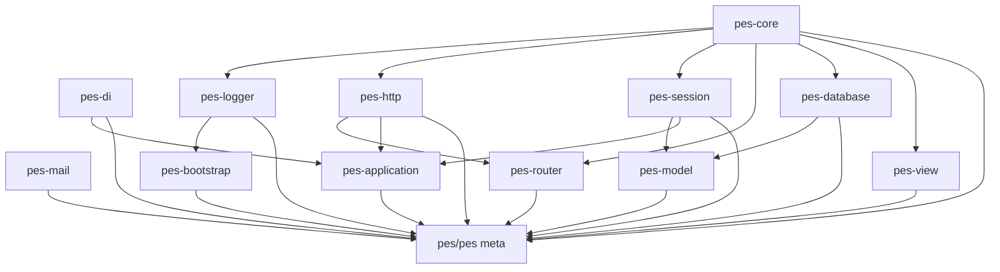

# Rozdělení monorepa `pes/pes` na Composer balíčky

**Zdroj pravdy (vývoj):** větev `split` v `https://github.com/box4pes/pes`.  
**Release line:** `8.27` — interní `require` mezi balíčky používají `^8.27` (ne `@dev`).  
**Verze:** z git tagů (např. `v8.27.0`); root `composer.json` **nemá** hardcoded `version`.  
**Širší plán (Packagist / split repo):** viz plán dokončení rozdělení (Agent Store / projektová dokumentace mimo monorepo).

## Cílové balíčky

| Balíček | Namespace (PSR-4) | Adresář | Závislosti (Pes) |
|---------|-------------------|---------|------------------|
| `pes/pes-core` | `Pes\Core\` | `pes-core/` | — |
| `pes/pes-di` | `Pes\Container\` | `pes-di/` | — |
| `pes/pes-mail` | `Pes\Mail\` | `pes-mail/` | — (phpmailer + psr/log) |
| `pes/pes-logger` | `Pes\Logger\` | `pes-logger/` | `pes-core` |
| `pes/pes-http` | `Pes\Http\` | `pes-http/` | `pes-core` |
| `pes/pes-session` | `Pes\Session\` | `pes-session/` | `pes-core` |
| `pes/pes-router` | `Pes\Router\` | `pes-router/` | `pes-core` + `pes-http` |
| `pes/pes-database` | `Pes\Database\`, `Pes\Query\` | `pes-database/` | `pes-core` |
| `pes/pes-view` | `Pes\View\` | `pes-view/` | `pes-core` |
| `pes/pes-bootstrap` | `Pes\Bootstrap\` + `bootstrap/*.php` | `pes-bootstrap/` | `pes-logger` |
| `pes/pes-model` | `Pes\Model\` | `pes-model/` | `pes-database` + `pes-session` |
| `pes/pes-application` | `Pes\Application\` | `pes-application/` | `pes-http` + `pes-di` + `pes-session` |
| `pes/pes` (meta) | `Acl`, `Autoloader`, `Config`, `Entity`, `Readers`, `Repository`, `Storage` | `src/` | všechny výše |

Procedurální soubory v `pes-bootstrap/bootstrap/` jsou mimo PSR-4; doručují se v dist a načítají se přes `BootstrapEntry`.

## DAG závislostí (publish pořadí = list → kořen)

```
pes-core
pes-di
pes-mail                    (jen phpmailer + psr/log)
   ├─ pes-logger ← pes-core
   ├─ pes-http ← pes-core
   ├─ pes-session ← pes-core
   ├─ pes-router ← pes-core + pes-http
   ├─ pes-database ← pes-core
   ├─ pes-view ← pes-core
   ├─ pes-bootstrap ← pes-logger
   ├─ pes-model ← pes-database + pes-session
   └─ pes-application ← pes-http + pes-di + pes-session
pes/pes (meta) ← všechny výše
```



## Lokální vývoj (path)

Kořenový `composer.json` má `repositories` typu `path` + `symlink: true` na všechny `pes-*`.  
Branch alias: `dev-split` / `dev-master` → `8.27.x-dev` (`extra.branch-alias`), aby `^8.27` fungovalo i před Packagist tagy.

```bash
composer install
composer test
composer dump-autoload -o
```

## Úklid před publish

- Odstraněn `pes-core/src/Text/messageTestQ.php` (testovací šum s `Pes\Logger` — falešný dojem cyklu core↔logger).
- `pes-session/vzory/` — referenční / cizí vzory (Aura); **nejsou** součástí dist (`archive.exclude`).

## Tagovací konvence (Fáze B)

- Sdílené číslo verze sady: **8.27.0** (první split release; major 8 = PHP 8 řada).
- Monorepo tag: `v8.27.0` (všechny balíčky najednou).
- Split repo (až existují): stejný tag `v8.27.0` na každém `box4pes/pes-*`.
- Interní require: `"pes/pes-core": "^8.27"` (ne `@dev`, ne `*`).

## Co zbývá mimo monorepo (neřeší tento dokument)

1. GitHub repozitáře `box4pes/pes-*` + subtree/splitsh automatizace.
2. Registrace na Packagist (list first podle DAG).
3. Spotřebitelé (`grafiaware/web`) — odstranit path repositories až po Packagist release.

Dokud Packagist `pes/pes-*` neexistují, path checkout monorepa zůstává nutný pro instalaci meta `pes/pes`.

## Migrace namespace

`tools/Migrate-PesSplit.ps1` (+ `tools/Migrate.txt`) pro spotřebitele se starými namespace.
